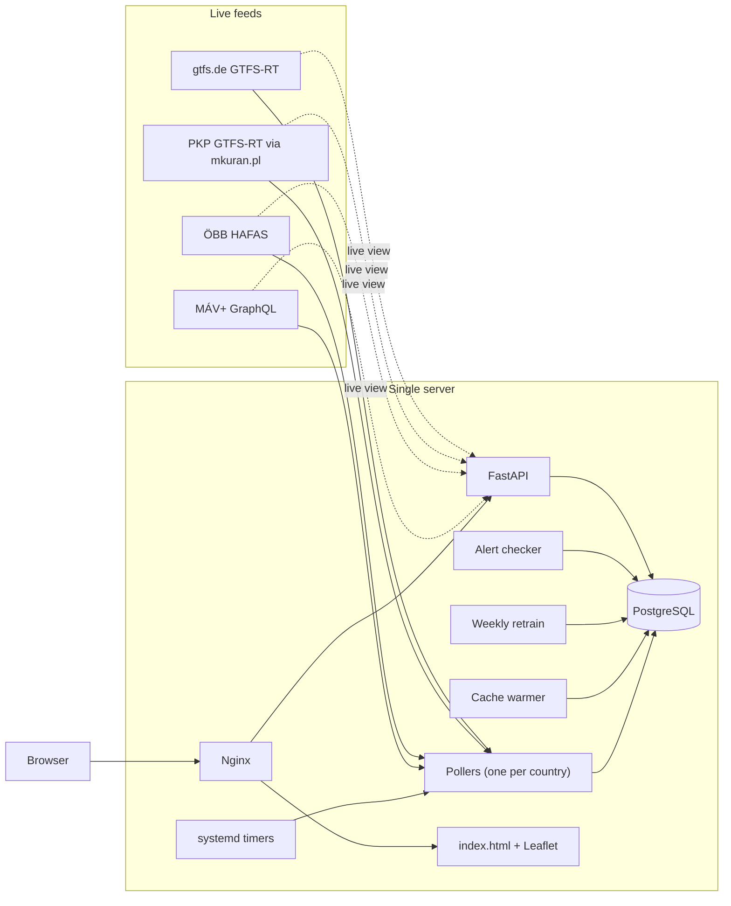
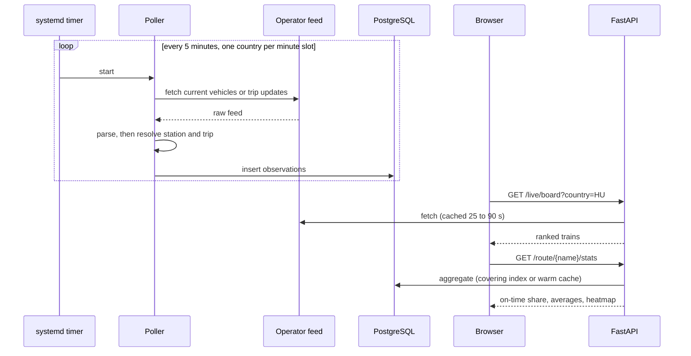

# LiveRail

A live train delay tracker for Hungary, Austria, Poland and Germany. It polls each country's real-time feed every five minutes, stores every observation in PostgreSQL, and uses the accumulated history to answer questions the operators' own apps do not: how often is this train late at this stop, and will this connection work.

**Status: archived.** I no longer host or develop it. The reasons are in [Why it stopped](#why-it-stopped).

## What it does

- **Live board and map.** Every train currently running in a country, ranked by delay, with a position on the map.
- **Per-train pages.** The current journey, how that train behaved on earlier days, and which stops it tends to lose time at.
- **History.** Station and route reliability, delay heatmaps by weekday and hour, operator rankings, CSV export.
- **Connection risk.** For a journey with a change, the chance the change works, with the reason stated when the data is too thin to say.
- **Delay alerts.** Web Push notifications for a watched train (browsers only allow this over HTTPS).
- **Compensation check.** Applies each operator's refund rules to a delay or a cancellation.
- **Typo-tolerant search** over stations and routes, plus server-rendered pages for search engines.

## How it works



Each poller turns its feed into rows of `(station, trip, delay)` and appends them to `delay_observations`. The API reads the same feeds directly for the live view, and reads the database for everything historical.



The four countries expose very different data, so most of the work is in the per-country adapters. See [docs/data-sources.md](docs/data-sources.md).

## Stack

Python 3, FastAPI, PostgreSQL (psycopg2), pandas and numpy, LightGBM, a small Node script around `hafas-client` for Austria, a vanilla JavaScript frontend with Leaflet, Nginx, systemd.

## Running it

```bash
pip install -r requirements.txt
(cd hafas && npm install)          # Austria only

cp .env.example .env               # set TRAIN_DB_PASSWORD
sudo -u postgres psql -c "CREATE ROLE trainuser LOGIN PASSWORD '<same password>'"
sudo -u postgres createdb train_delay_db
sudo -u postgres psql train_delay_db -f schema/schema.sql
for f in schema/01[0-7]_*.sql; do sudo -u postgres psql train_delay_db -f "$f"; done

python3 import.py --country HU --gtfs-dir <dir with stops/routes/trips.txt>
python3 poller.py                  # one poll; austria_poller.py etc. for the others
uvicorn api:app --port 8000
```

`schema/schema.sql` is the flattened result of migrations `002` to `009`, so a fresh database applies it first and then migrations `010` to `017`, all of which are safe to re-run. The two data repairs (`007`, `009`) only matter for the original production database. Static feeds, per-country import flags and the production setup are in [docs/data-sources.md](docs/data-sources.md) and [docs/deployment.md](docs/deployment.md).

```bash
pytest tests/                      # fast suite, no database needed
pytest tests/ -m slow              # the whole-country API tests, need a populated database
```

## Repository layout

| Path | What is in it |
|---|---|
| `poller.py`, `austria_poller.py`, `poland_poller.py`, `germany_poller.py` | One adapter per country |
| `trip_resolution.py`, `station_names.py`, `hu_route_names.py`, `at_route_names.py` | Shared matching and cleaning logic |
| `api.py` | FastAPI app: live view, history, search, transfer risk, alerts |
| `index.html`, `sw.js` | Frontend and service worker |
| `forecast.py`, `delay_forecast.py`, `transfer_model.py`, `model_loop.py`, `transfer_backtest.py` | Delay forecasting and transfer-risk models |
| `push_alerts.py`, `monitor.py` | Alert delivery and poller health checks |
| `import.py`, `refresh_static_feeds.py` | Loading and refreshing GTFS static data |
| `schema/` | Full schema dump and numbered migrations |
| `hafas/` | Node scripts for Austrian live data and journey search |
| `deploy/` | systemd units, nginx config, logrotate |
| `analysis/` | One-off investigations into what explains a delay |
| `tests/` | Unit tests and API tests |

## Documentation

- [Data sources](docs/data-sources.md): what each country publishes, and how each feed is made to fit one schema
- [Schema](docs/schema.md): tables, relationships, migrations
- [Delay forecasting](docs/delay-forecasting.md): what the data says about delays, and the models built on it
- [Testing](docs/testing.md): the fast and slow test split
- [Deployment](docs/deployment.md): server setup, scheduling, backups, moving to a new machine

## Why it stopped

LiveRail ran on one small AWS instance (2 burstable vCPUs, 2 GB of RAM, no longer free-tier eligible). The four pollers, the API, the alert checker and a weekly model retrain all shared it.

The database was the problem. It grew to roughly 12 GB, more than half of that indexes, on a machine that could keep only a fraction of it in memory. Anything that aggregated a whole country's history went to disk. Cold, those queries took 8 to 35 seconds. I fixed them one at a time with covering indexes, precomputed tables and a background cache warmer, but each was a separate round of diagnosis, and every new feature added another aggregate to keep fast. Taking a 12 GB backup was enough to evict the database's page cache and make every aggregate slow again afterwards.

Fixing it properly meant paying for a larger server, and the project earned nothing. I decided that was not worth it and stopped. The repository is what remains: the collection pipeline, the data model, and the analysis that came out of it.

## What I learned

- **Plan storage before collecting.** The Polish and German feeds repeat an unchanged delay on every poll, so writing a row per poll stored about 190 times more rows than there were distinct values for Poland. Skipping unchanged values cut the table from 54 million rows to 15 million. That should have been a design decision on day one, not a repair.
- **Keep heavy aggregates out of the request path.** Precomputing percentiles and the search index, and caching summaries, turned 30-second endpoints into millisecond ones. Doing it from the start would have been cheaper than doing it after each timeout.
- **Check the database against the real feed, not only the logs.** The Hungarian and Austrian pollers reported rows as saved that were never written, and Austria silently dropped a third of its trains. Nothing in the logs showed either. Comparing what the feed contained with what the database held found both.
- **Do not force one identity across sources.** Each operator identifies a train differently, and some do not expose a usable id at all. Storing each country's own id, and resolving to the schedule only where that works, was more reliable than a unified scheme.
- **Make leakage structurally impossible.** My first forecasting model for Germany looked 12.5% better than the baseline. The gain came from a feature that contained its own label, and the honest figure was 1.5%. Splitting by date and fitting history statistics on earlier days only removed that class of leak.
- **Gate automated retraining.** A model that retrains itself needs a rule for when its new version replaces the old one. Mine only promotes a model that beats the incumbent on held-out data, on the metric that matters.
- **Check the data licence early.** The Hungarian feed has no published licence that I could find, which blocks any commercial use. That is worth settling before building on a feed.
