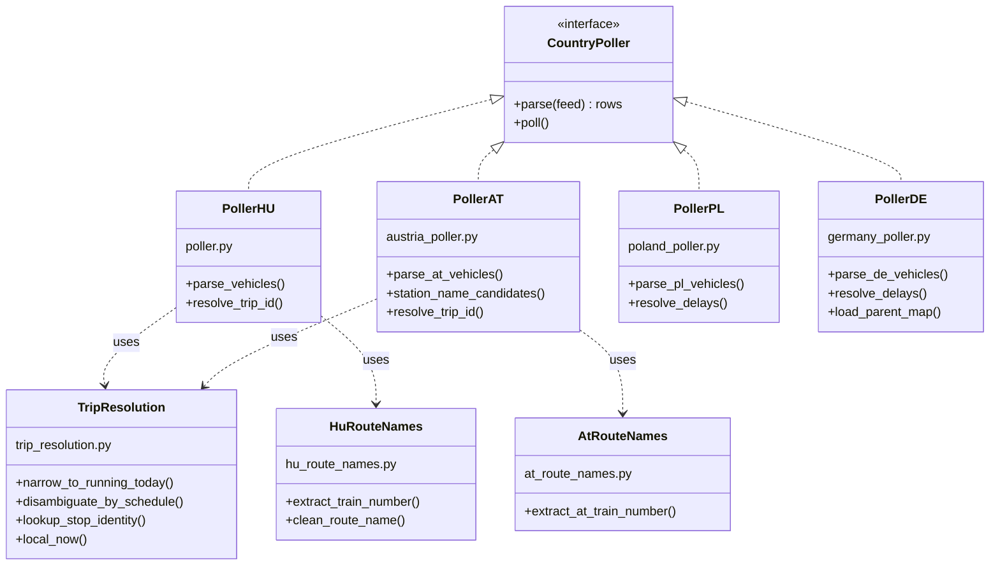
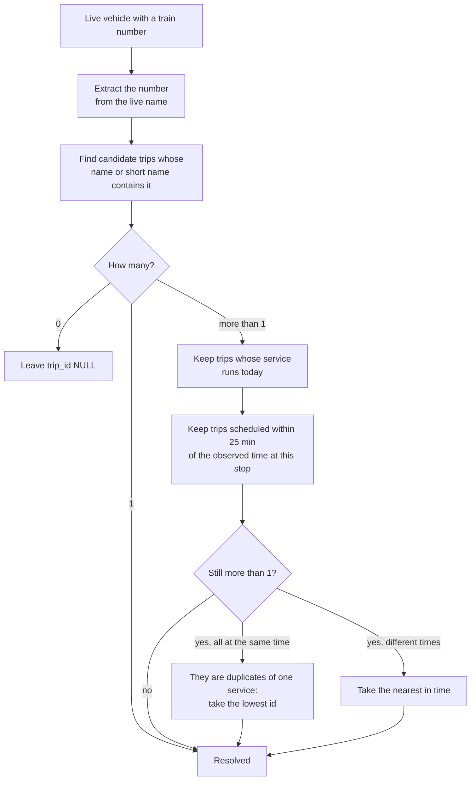

# Data sources

Each country publishes live and schedule data in a different shape. The goal is to land all of it in one table, `delay_observations`, joined to a common schedule model (`stations`, `routes`, `trips`, `stop_times`). Most of the code is the per-country adapter that makes that possible.

| | Hungary | Austria | Poland | Germany |
|---|---|---|---|---|
| Live source | MÁV+ OTP GraphQL, vehicle positions | ÖBB HAFAS through `hafas-client`, run as one-shot Node scripts | GTFS-RT TripUpdates published by mkuran.pl | gtfs.de GTFS-RT stream |
| Schedule source | MÁV GTFS | ÖBB GTFS | mkuran.pl `polish_trains` GTFS | gtfs.de `fv_free` and `rv_free` GTFS |
| Delay in the feed | Yes | Departure delay only | No, computed from timestamps | Yes |
| Train identity | Public train number | Opaque HAFAS id, plus train number | GTFS trip id | GTFS trip id, reissued each service day |
| Licence | None published that I could find | CC BY 4.0 (schedule) | CC BY 4.0, derived from PKP PLK public sector data | CC BY 4.0 (schedule), CC BY-SA 4.0 (realtime) |

Attribution text per country lives in `COUNTRY_ATTRIBUTION` in `api.py` and is shown in the page footer.

## One adapter per country

Every poller follows the same split. A pure `parse` function turns the raw feed into plain rows and touches no database, so it can be unit-tested against a fixture. A separate step resolves those rows against the schedule tables, and only that step needs a database.

The live view in `api.py` reuses the same parse functions through a small registry (`_LIVE_PROVIDERS`): one fetch function and one cache lifetime per country. Adding a country to the live view is one function and one registry entry.

## Hungary

- **Feed.** MÁV+ runs an OpenTripPlanner instance. Its GraphQL endpoint returns every running vehicle with its trip, next stop and delay.
- **Route names.** `route.longName` is not a stable identifier. For local trains it is a slash-joined list of every train number that has run on that pattern, and the list changes from day to day. `clean_route_name()` turns those into `"<category> <this train's number>"` using `tripShortName`. `routeShortName` is unusable, because MÁV renders it with a custom icon font.
- **Trip identity.** OTP's own trip ids do not exist in the static GTFS, so no string transform joins them. The train's public number does appear in both, so it is used to find candidate trips (see below).
- **Cancellations.** The vehicle feed only describes running trains, so a cancelled train is absent rather than flagged. The poller reads the cancellation field anyway in case MÁV starts publishing it.
- **Station matching.** Live stop names are matched to the static feed by name. The Budapest suburban railway (HÉV) is a different agency and is not in MÁV's static export, so its stations were missing and every HÉV observation was silently discarded. `import_hu_missing_stations.py` adds them, after which no observation is dropped.

## Austria

- **Feed.** `hafas-client` with the ÖBB profile, run as a one-shot Node subprocess per call (`hafas/radar.js` for the live map, `trip.js` for a single journey, `journeys.js` for journey planning). A persistent Node service would not fit in the memory of the server. The hosted `oebb.transport.rest` wrapper no longer resolves.
- **Result cap.** `radar()` returns 256 results by default, which silently dropped about 90% of the national feed. The cap was raised to 2000, which turned out to truncate again at evening peak (2,143 movements), so the poller now requests up to 4000. `monitor.py` flags a response that comes back exactly at the cap, since this will recur as traffic grows.
- **Trams and U-Bahn.** HAFAS labels Vienna's trams and U-Bahn as mode `train`, separated from rail only by product. ÖBB's rail GTFS contains no tram stops, so almost none of those rows could resolve to a station. They are excluded, which also drops a few genuine tram-train services.
- **Station names.** HAFAS and GTFS disagree on formatting (`Hbf` against `Hauptbahnhof`, a missing space after an abbreviating dot, parenthetical qualifiers). `station_name_candidates()` tries a list of normalised variants in order.
- **Delays.** `radar()` never sets an arrival delay, only a departure delay, so `delay_arrival_minutes` is NULL for Austria. Filling it from the departure delay would invent a figure ÖBB never published. `trip()` does carry both, so the per-train page has them.
- **Trains without a delay figure.** About a third of moving trains have no delay published yet for their next stop. They are kept in the live view, marked unknown, and not stored in history, because a NULL delay contributes nothing to a delay distribution.

## Poland

- **Feed.** A GTFS-RT TripUpdates feed that carries only `trip_id`, `stop_sequence` and absolute timestamps. It has no `stop_id`, no `route_id` and no delay. The delay is computed by joining each update to our own `stop_times` and subtracting the scheduled time (in `Europe/Warsaw`, handling times past 24:00:00 for overnight services). This needs the `stop_times` table, which is why Poland was the first country imported with `--with-stop-times`.
- **Plausibility guard.** The feed sometimes disagrees with the schedule snapshot about `stop_sequence` numbering, producing delays of about 20 hours. Anything over `MAX_PLAUSIBLE_DELAY_MIN = 720` is discarded.
- **Duplicate services.** Two entities can be active for one recurring trip at once (an overnight service still on yesterday's start date plus today's). Our schedule tables have no per-day rows, so both resolve identically and are collapsed to one.
- **Live view.** A TripUpdates feed describes the whole day's schedule against reality, not vehicle positions. A naive live view of it lists every resolvable update (over 20,000 rows) rather than the trains in motion, so positions are estimated by interpolating between the previous and next scheduled stop.

## Germany

- **Feed.** gtfs.de aggregates about twenty regional feeds into one GTFS-RT stream. It sets the delay directly, so Germany needs none of Poland's join machinery.
- **Why not HAFAS.** The two HAFAS-based options, a hosted `db.transport.rest` API and a self-hosted `hafas-client` with the DB profile, were both dead when I checked. The first reported that DB had shut its HAFAS API off, and the second failed with `ENOTFOUND reiseauskunft.bahn.de`.
- **Child stops.** The realtime feed's `stop_id` is always a platform-level child row, never the top-level station that `import.py` keeps. `load_parent_map()` translates child to parent before looking up the station. Before this, zero rows resolved.
- **Two schedule feeds.** Long-distance (`fv_free`) and regional (`rv_free`) are separate zips, imported into one country. Their `route_id` values collide (97 of 97 long-distance ids match an unrelated regional route), so `import.py --route-id-prefix` namespaces them. Stop ids and trip ids are genuinely shared and are left alone.
- **Reissued ids.** gtfs.de reissues `stop_id` between exports and `trip_id` for each service day. The first breaks the station table: a re-import splits one station into two, orphaning its history, and `schema/007` and `schema/009` merge them back. The second means a specific train cannot be followed across days by trip id, which limits per-train statistics for Germany.
- **Coverage.** About 30,000 stop updates arrive per poll. Around 5,000 resolve against the rail-only schedule, since most of the rest is bus and tram traffic from the contributing authorities. Of those, only about 130 are long-distance trains, so the coverage is DB Regio and S-Bahn networks, not ICE and IC.
- **Remaining stops only.** The feed lists only a trip's remaining stops, so the per-train page for Germany says so instead of implying a full route.

## Resolving a train to the schedule (Hungary and Austria)

Poland and Germany give a trip id that joins directly. Hungary and Austria give only a train number (and, for Austria, an opaque id), so a number has to be narrowed down to one scheduled trip.

Three details made this work:

- **Calendar before time.** Many candidates turned out to be one physical service duplicated once per calendar pattern, all with identical scheduled times. Narrowing to the services that actually run today (from `calendar.txt`) is what broke the tie, not the time comparison.
- **Local time.** The server clock is UTC and GTFS times are local wall-clock strings. Comparing them without converting was wrong by up to two hours. `local_now()` converts per country.
- **Unresolved is allowed.** If the number does not identify one trip, `trip_id` stays NULL and the opaque feed id is stored as `live_trip_id`. A wrong guess would put a row in another train's history.

Measured resolution rates move with the time of day and the mix of services. Hungary resolved about 60% of vehicles in daytime samples and about 35% at night, when most services are rail-replacement buses. Austria resolved about 40% of all live vehicles and about 60% of those with any candidate in ÖBB's own feed.

## Static feeds

`import.py` loads a GTFS directory for one country: `--country`, `--gtfs-dir`, `--with-stop-times` (Poland needs it to compute delays, the other countries use it for stop identity), `--route-id-prefix` and `--service-id-prefix` for feeds assembled from several zips. Stops are filtered to real stations (rows without a `parent_station`), because platform-level rows would otherwise duplicate every station.

`refresh_static_feeds.py` re-downloads and re-imports the feeds on a monthly schedule and merges stations that a re-import splits. The merge reads the dependent tables from the Postgres catalog and refuses to run on one it cannot classify, so a table added later cannot be half-merged.

## Checking that nothing is lost

Most bugs in this project were silent losses: a row that never reached the table, and no error. Two habits came out of that.

- Pollers count `cursor.rowcount`, the rows the database accepted, instead of the rows they attempted. The old counter reported every observation as saved even when the station lookup matched nothing and the insert wrote zero rows.
- `monitor.py` tracks each country's resolve ratio over time (`resolve_history`), so a slow decay is visible, not only a collapse below a fixed floor.
