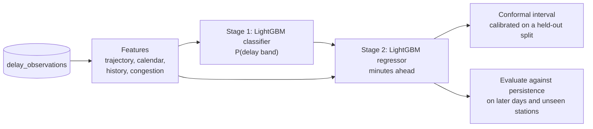
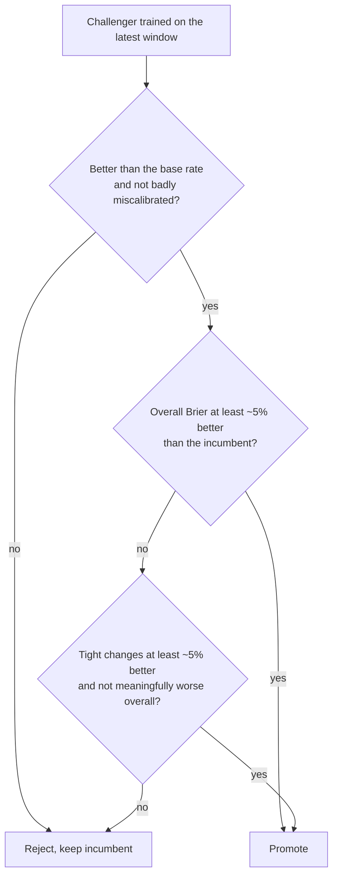

# Delay forecasting

What the collected history says about delays, and the models built on it. All figures were measured on the project's own database, on about three weeks of history for Austria, Poland and Germany and about four months for Hungary. The models were not wired to any public endpoint except transfer risk, because the margins were thin and the history short.

## Pipeline

- **Stage 1** predicts a delay band (up to 2, 5, 10, 20, 40 minutes, over 40), the same tiers the app colours by.
- **Stage 2** predicts minutes and takes stage 1's probabilities as extra features.
- **The interval** comes from two quantile models whose width is calibrated on a split that trained neither, so the stated 90% coverage is checked rather than hoped for (conformalised quantile regression).
- **Features** are generated in families: the train's own trajectory (current delay, slope, stops elapsed), calendar, history (station, route, and this train at this stop, as median, p90 and count), and congestion (how many other trains are at the target and current stations in the 15 and 60 minutes before the prediction).

The code is `forecast.py` and `delay_forecast.py`.

## The baseline is hard to beat

"Assume the delay stays the same" is a strong predictor. A published graph-attention model trained on over 40% of the Dutch network reports 1.09 minutes MAE against 0.97 for persistence. Its value is in classifying delay events, not predicting minutes. So a large MAE win over persistence should be suspected of leakage before it is believed, which turned out to apply here.

## Two leaks

**The congestion feature read the future.** The first version reported +12.5% MAE over persistence for Germany and ranked congestion second in importance, which looked like the model had found knock-on delay. The feature was keyed on the target station in the target hour. That hour has not happened at prediction time, and its cell contains the row being predicted. 34% of (station, day, hour) cells hold exactly one observation, so for a third of samples the feature was the label. Corrected, the gain was +1.5% and congestion fell out of the top twelve.

**History was fitted on its own labels.** "This train at this stop" was computed from the training rows themselves. Germany reissues `trip_id` every service day, so a trip usually appears once, and the statistic was the median of its own label. The symptom is worth remembering: that feature ranked first by gain while the model lost to persistence by 60%. Huge training gain with catastrophic test error means a feature that exists in training and vanishes at test time.

The fix was structural. Days are split chronologically, a fifth of stations are held out entirely, history statistics use only strictly earlier days (an expanding window, which is also what production does), and congestion windows are half-open and in the past. After the fix Hungary improved and Germany got worse, and a leak that flatters one country and not another points at the data and not the model.

## Results

On held-out later days and unseen stations:

| | MAE, persistence | MAE, model | Brier "late over 5 min", persistence | Brier, model |
|---|---|---|---|---|
| Hungary | 4.180 | 3.237 (22.6% better) | 0.2340 | 0.1244 |
| Germany | 2.011 | 2.200 (9.4% worse) | 0.0989 | 0.0792 |

- **Hungary** wins on both metrics and at every horizon from 1 to 8 stops. The 90% interval covers 90.2% of outcomes at a median width of 9.7 minutes.
- **Germany** loses on minutes and wins on the decision, the same split the Dutch paper found. A gate that compares each horizon to persistence correctly declines to use the model anywhere for Germany.

**Why they differ** is data and not modelling. Hungary's `route_name` is a stable per-train key, so the same train recurs daily and the per-stop history is dense. Germany's trip ids do not recur (none of 228,547 trip and station combinations appear on 8 or more days), so Germany's model runs on the train's own trajectory alone. A synthetic key of route, scheduled time and station recurs 4.4 times as densely, but still only about 18% of pairs recur on three days.

**Two negative results are kept.** Two-stage stacking did not improve MAE (2.3% worse for Hungary, 8.0% worse for Germany against one stage), so the published gain did not reproduce. The stacking stays because the classifier is the useful output, not the minutes. And a route-at-station history key, added to rescue Germany, did not appear among its top features. Six days is probably too few.

## What explains a delay beyond "it was late"

Investigations in `analysis/`, each against the full database.

- **Delay coupling between trains is real.** A late arrival becomes a late departure under another train number when stock and crews rotate. After removing each train's own typical lateness, Hungarian train pairs seen 10 to 75 minutes apart at one station showed a mean correlation of +0.21 against +0.001 when shuffled across days. Strong positive couplings were 4.4 times as common as chance, and strong negative ones were rarer than chance, which noise cannot do. Hungary only, because Germany's ids do not recur.
- **Absorbing and amplifying segments are a property of the timetable, not the track.** Of 209 German segments with enough data, 21 absorb delay and 18 amplify it, by about a minute. For 187 segments seen in both directions, the correlation between the two directions' behaviour was +0.08. Geometry would make both directions alike. Padding is set per direction.
- **Small delays are recovered, and on-time trains lose time.** Trains over three minutes late recover 0.22 minutes per segment, and on-time or early trains lose 0.14. A late train has slack to claim back and an on-time one has none. A model fitted to this does not beat "no change" (MAE 0.554 against 0.494), so the empirical table is the trustworthy form of the finding.
- **A measurement trap.** Adjacent stops sometimes showed a delay jumping from 0 to 85 and back to 1. A stop's stored delay is only as fresh as the last time it was in the sampling window, so comparing two stops can compare a close-in reading with a forecast made before the disruption. 26% of adjacent pairs were more than 15 minutes apart. Dropping them cut mean absolute error from 0.72 to 0.46. Any per-segment analysis has to apply the same freshness guard, or it measures the poller and not the railway.

## Connection risk

`/transfer/risk` answers whether a change between two trains will work. The first version convolved the two trains' delay percentiles as if they were independent, and nobody had checked it.

**The backtest** (`transfer_backtest.py`) builds labelled outcomes from the archive: two different trains at one station on one day, with the scheduled buffer from `stop_times` and both real delays. Germany alone yields 3.94 million such pairs. Distributions are fitted only on days before the test day, and whole stations are held out. The honest claim is that the change was physically possible, since trains are observed and passengers are not.

| Model | Brier, Germany | Brier, Poland |
|---|---|---|
| Always the base rate | 0.0698 | 0.0703 |
| "Buffer of 5 minutes or more works" | 0.0893 | 0.0999 |
| Independent delay percentiles | 0.0403 | 0.0395 |
| Two-component lognormal mixture | 0.0350 | 0.0377 |
| LightGBM champion (weekly gate) | 0.0296 | tight changes 10.6% better |

The independent model was too pessimistic in every bin. It predicted 3.4% where 19.8% of tight connections worked. Delays cluster by place and time (the spread between station-hours is two to five times the mean), and correlated delay protects a transfer: if both trains are 20 minutes late, the buffer survives.

Two things went wrong on the way:

- **Interchange time cannot be fitted from train data.** The label is defined using it, so any search drives it to zero, where every change counts as made. It is identifiable only against evidence of what passengers did. The code reports a sensitivity sweep instead, and the interchange time is stated as an assumption wherever a figure is shown.
- **The mixture returned exactly 1.0 for a 30-minute buffer.** Cancelled rows carry a NULL delay and are excluded from every percentile, so the figure is conditional on the train running. It is now multiplied by the chance that it runs and capped at 0.99, because a strike or a closure is in no delay distribution.

### Serving a model without train/serve skew

`transfer_model.py` serves the promoted champion as the first answer, then the mixture, then the raw percentiles, and the response names which one answered. Nine of its twelve features are delay statistics fitted on the training window. Recomputing them at request time would feed the model numbers it never trained on, and the predictions would stay plausible while being wrong. So the exact statistics are saved beside the booster and read back verbatim. A champion saved without them is refused, and a test compares the serving feature row against the training one on identical inputs.

### The promotion gate

`judge()` in `model_loop.py` is a pure function, because it is the whole safety argument for unattended retraining, and `tests/test_model_gate.py` pins each refusal. The second path exists because the first could not see the improvement that mattered. Tight changes are 12% of Poland's test set and only 57% of them succeed, while the other 88% succeed about 94% of the time. A tight-only gain is diluted about eightfold in the overall score, so the overall bar was silently demanding a tight improvement nobody had chosen. The tight bar was not tuned to let Poland through, and Germany clears it independently at 6.9%.

`retrain.sh` runs weekly rather than nightly. Patterns move on the scale of timetable periods, and a gate asked to judge seven times a week on near-identical data will eventually promote noise. Hungary and Austria were too thin to judge when this was written, because a transfer needs a resolved `trip_id` on both trains and that shipped only recently there.

## What would come next

1. **A stable cross-day train identity** for Germany, Austria and Poland. It is the highest-value item, and it is data work, not modelling.
2. **Pair-level coupling features**, the one confirmed effect that aggregate statistics cannot see.
3. **Serve the classifier, not the regressor**: "how likely is this train to be late at your stop", calibrated, plus a conformal arrival interval.
4. **Weather**, which every survey names and this project holds none of.
5. **More history.** Every figure here rests on weeks, not seasons.

## References

- Deep learning to identify the spatio-temporal cascading effects of train delays in a high-density network (arXiv 2510.09350): graph-attention model, persistence comparison, congestion features.
- Laifa et al., Predicting train delays using a two-level machine learning approach (ICAART 2022).
- Romano, Patterson and Candès, Conformalized quantile regression (2019), and its application to railways in Reliable train delay forecasting with conformal prediction.
- arXiv 2504.17479, the source of the two backtest guards: fit only on earlier days, hold out whole stations.
