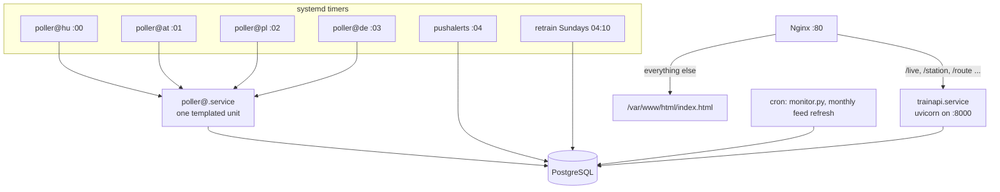

# Deployment

The whole system ran on one Ubuntu 24.04 server: PostgreSQL, Nginx, the API under systemd, and everything scheduled. Configuration is in `deploy/`. The configs assume the repository is checked out at `/home/ubuntu/liverail`, with every service running from `backend/`.

## Layout

## Scheduling

All four pollers run under one templated unit, `poller@.service`. Each `poller@<code>.timer` starts `poller@<code>.service`, which reads `/etc/poller-instances/<code>.conf` to learn which script to run. Adding a country is one `.conf` and one `.timer`.

Three lessons are baked into these files:

- **Absolute slots, not intervals.** Timers use `OnCalendar=*:0/5:00` for Hungary, `*:1/5:00` for Austria, and so on. `OnUnitActiveSec=` counts from each unit's own last trigger, so any manual run re-synchronised two timers and they then stayed locked together. All four collided twice before this was fixed. Four pollers on one vCPU at the same instant also slowed the API.
- **`User=ubuntu` is required.** Python packages are installed into that user's home, invisible to root. Poland's first run failed with `ModuleNotFoundError` because a hand-copied unit omitted it, which is why the unit became a template.
- **Log paths use `%i`.** Variables from `EnvironmentFile=` expand in `ExecStart=` but not in `StandardOutput=`, so log files are named with the systemd specifier (`hu_poller.log`, `at_poller.log`, ...).

`pushalerts.timer` takes the `:04` slot, after all four pollers have written the state it reads. `deploy/retrain.sh` runs Sundays after the nightly backup, trains the four countries sequentially, and logs to `retrain.log`. Running two LightGBM trainings at once would starve everything else on the machine.

`deploy/crontab.txt` holds the remaining jobs: `monitor.py` every 15 minutes (with a deeper check hourly), and a monthly `refresh_static_feeds.py` for Austria, Poland and Germany. Hungary's static feed is refreshed by hand.

## Nginx

`deploy/nginx/default` serves the contents of `web/` (copied to `/var/www/html`) and proxies API paths to `127.0.0.1:8000`. The frontend uses same-origin requests, so it never needs to know the server's address. An earlier build hardcoded the public IP, and an instance restart changed the IP and silently broke every API call while the static page still loaded.

The proxy matches on a path regex. Several times a new endpoint worked on port 8000 and returned 404 through Nginx because its prefix was missing from the regex, so the file is tracked and updated alongside each new endpoint. Do not leave a backup copy of the config inside `sites-enabled/`: Nginx loads it and fails on a duplicate default server.

`/sitemap.xml` has `proxy_read_timeout 120s`, because a cold build takes 60 to 90 seconds. A rate-limit zone (`deploy/nginx/ratelimit.conf`, 120 requests per minute per IP with a burst of 40) protects the single server from a traffic spike.

## Configuration

Secrets are in `backend/.env`, read by `config.py`, which raises at startup if `TRAIN_DB_PASSWORD` is missing instead of falling back to a default. `backend/.env.example` lists the keys: the database password, the VAPID key pair for Web Push, and an optional webhook for `monitor.py`.

Changing the VAPID keys invalidates every existing browser push subscription. Browsers only allow push over HTTPS, so alerts could not reach a rider while the site was served over plain HTTP on a bare IP.

## Backups and moving machines

The database is the one asset no feed can give back. Every live source describes only the present moment, so the observation history cannot be re-fetched. Code and configuration are in git, and static GTFS feeds can be downloaded again.

- **Dumps.** A nightly `pg_dump -Fc` (about 12 GB live, about 300 MB compressed), keeping seven days. The dump alone is not enough: a role's password is not in a single-database dump, so `.env` must be kept too. Plan for one copy off the server. Backing up to cloud storage in the same account as the server does not protect against losing the account.
- **A large dump evicts the page cache.** Right after a 12 GB dump, every aggregate query came off disk again and ran slowly until the cache warmed. Do not benchmark straight after a backup.
- **Moving to a new machine** is `deploy/migrate.sh`. `freeze` stops all scheduled writers, records row counts, and dumps. `restore` verifies the checksum, creates the role and database, and runs a parallel restore. `verify` compares counts against the old machine. The old machine stops first on purpose: two machines polling at once write divergent histories that cannot be merged. Expect a gap of 30 to 45 minutes, almost all of it index rebuilds.
- **Log rotation** (`deploy/logrotate/poller`) is daily with seven copies and `copytruncate`, so the pollers need no restart. Before it existed, one poller log reached 300 MB.

The backup script itself is not in this repository.

## PostgreSQL on a small machine

The server ran a stock configuration against a database of about 13 GB, of which about 8 GB was indexes. On a larger machine, set `shared_buffers` to about a quarter of RAM and `effective_cache_size` to about three quarters, and raise `maintenance_work_mem` before restoring, since index rebuilds are the slow part.

Do not set `random_page_cost=1.1` just because the disk is SSD. On this workload it made a station-board query three times slower (0.34 s to 0.77 s warm) by pushing the planner from a bitmap scan to per-row index scans. The advice assumes a cached working set, and this one was not. Measure both settings.

## Storage growth

Write volume is a design decision, not a tuning detail:

- Poland's and Germany's feeds repeat an unchanged delay every poll, so the pollers skip a row whose delay matches the last stored one. This took `delay_observations` from 54 million to 15 million rows.
- Germany's feed lists a train's remaining stops and the sampled stop advances as the train runs, so depth does not accumulate at any one stop. Recording every stop meant 6.1 times the write volume (about 27 GB per month). The poller records the next three stops per poll with a one-minute change threshold instead, which came to 1.67 times the original volume and about 7 GB per month. `STOPS_PER_POLL` is per poll, not per trip: one trip accumulated 74 recorded stops over a day, and 55% of trips recorded more than three.
- Cancelled rows are written with a NULL delay, not 0, so cancellations never count as on-time arrivals.

A retention policy was the missing piece: raw observations could be pruned once `delay_distribution` has aggregated them. It was never added, and that is part of why the project ended (see the [README](../README.md#why-it-stopped)).
