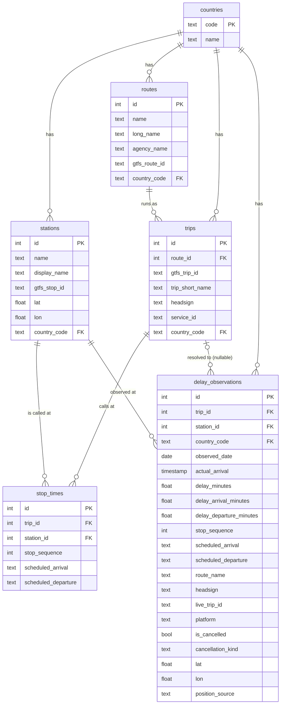
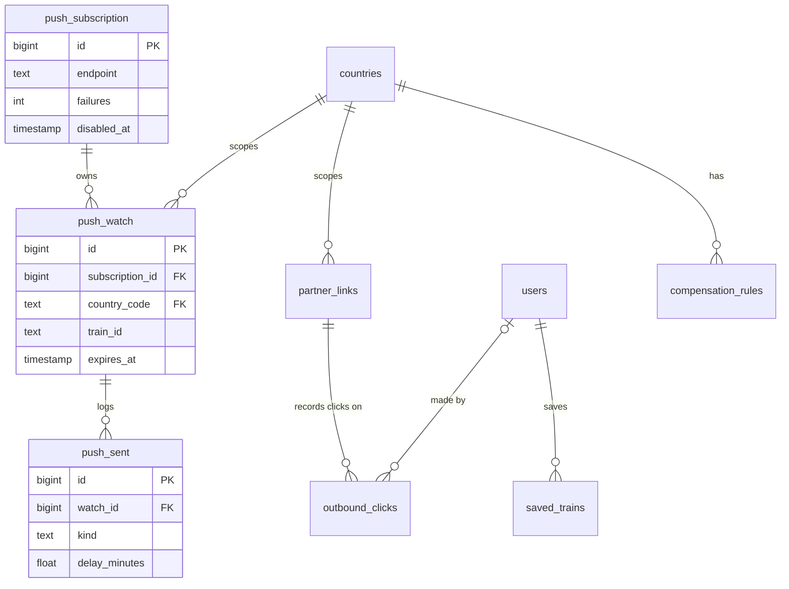
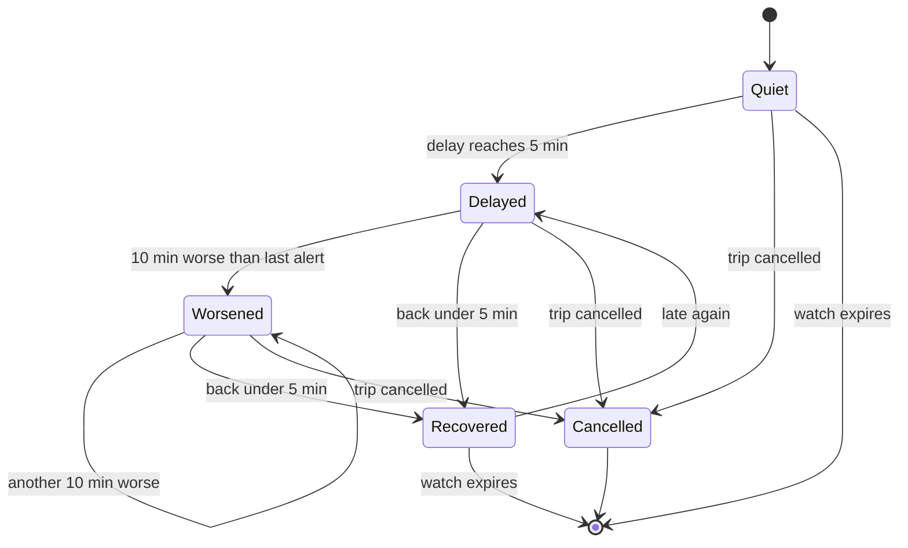

# Schema

PostgreSQL. `schema/schema.sql` is the flattened current structure (migrations `002` to `009`), and `schema/010` to `017` are applied after it. Every migration opens with a comment explaining why it exists, so the numbered files double as a record of how the model changed.

## Core model

Two halves: the **schedule** (static GTFS, loaded once per feed and refreshed monthly) and the **observations** (one row per delay reading, appended every five minutes).

### Choices in `delay_observations`

- **`trip_id` is nullable, and `live_trip_id` sits beside it.** Poland and Germany give an id that joins to `trips`. Hungary and Austria give only a train number, and a number does not always identify one trip, so `trip_id` is filled only when exactly one trip matches. Otherwise the feed's own opaque id is kept in `live_trip_id`, which is enough to follow one train across polls but not to join the schedule. See [data-sources.md](data-sources.md).
- **A cancelled row has `delay_minutes = NULL`, never 0.** A train that never arrives has no delay, and a 0 would count every cancellation as an on-time arrival, making an operator look better the more it cancels. `cancellation_kind` separates a cancelled trip (`trip`, recorded at its origin) from a skipped stop (`stop`).
- **Arrival and departure delay are stored separately.** A transfer depends on the feeder's arrival and the connector's departure, and they differ wherever a train waits. `delay_minutes` is kept for older queries.
- **Schedule times are raw text.** GTFS times are local wall-clock strings that can pass 24:00:00 for overnight services, so they are stored as given and converted with the country's timezone when used.
- **`stop_sequence` and the scheduled times identify the stop.** Before these existed a row said only that a train was late at a station, which is too coarse for a transfer.

### Indexes worth knowing

- `(route_name, country_code) INCLUDE (delay_minutes, actual_arrival)` and the same for `station_id` are **covering indexes**. They let route and station statistics run as index-only scans. A single busy route went from 11 seconds to 0.15 seconds.
- `(trip_id, observed_date) WHERE trip_id IS NOT NULL` is **partial**: only about 13% of rows have a `trip_id`, and an `= ANY(...)` lookup can never match NULL. It is 106 MB where the full index would have been about 2 GB. It was added after the Polish and German pollers' duplicate check turned out to be reading the table heap about 21,000 times every five minutes.
- `(station_id, observed_date)` serves the station board for a past day.
- Indexes that are built `CONCURRENTLY` show as invalid until the build finishes. That is progress, not failure.

## Derived and supporting tables

Derived tables are rebuilt by a background thread in `api.py`, so a request never pays for a whole-country aggregate.

| Table | Migration | Purpose |
|---|---|---|
| `service_calendar`, `service_date` | 002, 013 | Which services run on which day, from `calendar.txt` and, for Poland, from the trip list. Used to narrow ambiguous train numbers. |
| `search_index` | 006 | Every searchable name with a popularity count and a `pg_trgm` index, for typo-tolerant search. |
| `delay_distribution` | 012, 014 | Percentiles (p50, p75, p90, p95), sample counts and a fitted two-component mixture, per station on three levels: this trip, this route at the station, the station overall. |
| `model_eval` | 015 | Every retrain attempt with its scores and whether it was promoted. |
| `resolve_history` | 016 | The share of feed rows resolved to a station and trip, per country over time. |

Migrations `007` and `009` are data repairs for Germany's duplicated stations (see [data-sources.md](data-sources.md)), and `010` and `011` are indexes.

## Alerts, commerce and unused tables

- **Alerts have no login.** A browser's push subscription is the identity. A watch expires after 24 hours (the server caps it at 48) because a train id is not a train forever: gtfs.de reissues ids per service day and a Hungarian id can be reused for a different train, so a long watch could alert about the wrong one.
- **`compensation_rules`** holds each operator's refund thresholds, sourced from the operators' own passenger-rights pages. The three non-Hungarian operators follow the EU baseline (25% at 60 minutes, 50% at 120). Hungary's state operator pays from 30 minutes, but only on premium reserved-seat trains.
- **`partner_links`** points at each operator's own booking site and `/out/{id}` logs the click before redirecting. No affiliate account was ever set up.
- **`users` and `saved_trains`** were created for an account system that was never written and hold no rows.

## Alert decisions

A watched train is checked every five minutes for up to a day, which is 288 chances to say the same thing. Telling someone "your train is 12 minutes late" 288 times gets notifications switched off, so alerts fire on change. `decide()` in `push_alerts.py` is a pure function of the current reading and the last alert sent.

Two rules keep it honest. A cancellation is sent once and outranks any delay. An unknown delay never becomes "recovered": MÁV publishes no delay at a trip's final stop, even for an hour-late train, so a missing figure is not evidence that the train is on time.
